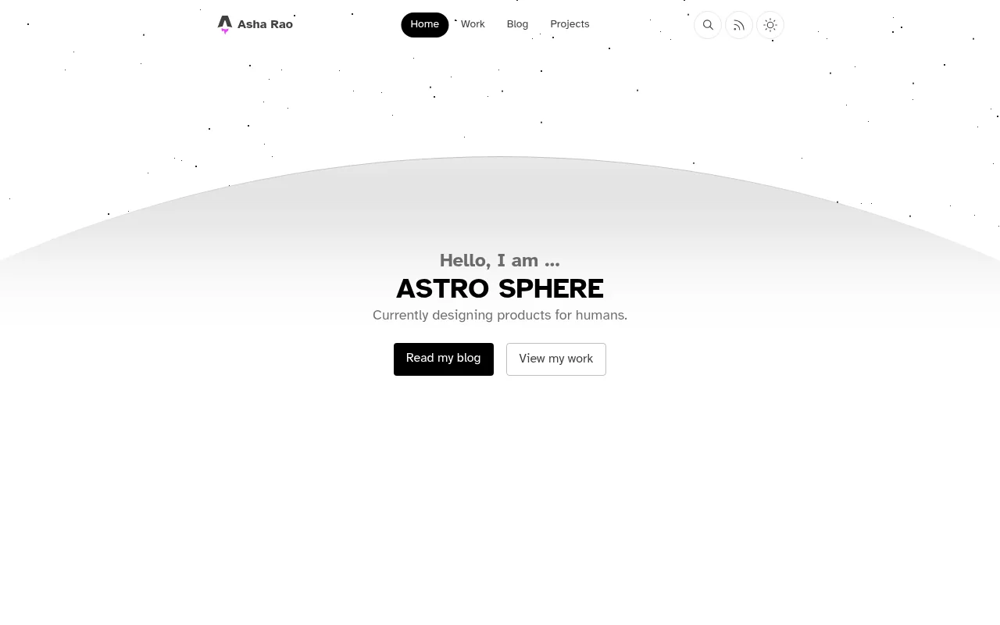
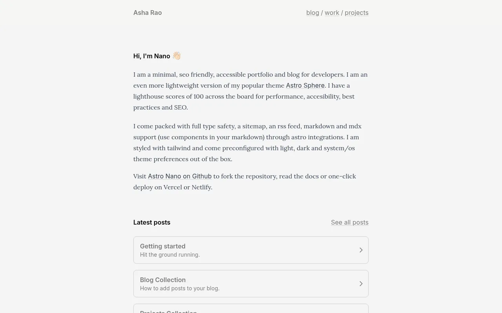
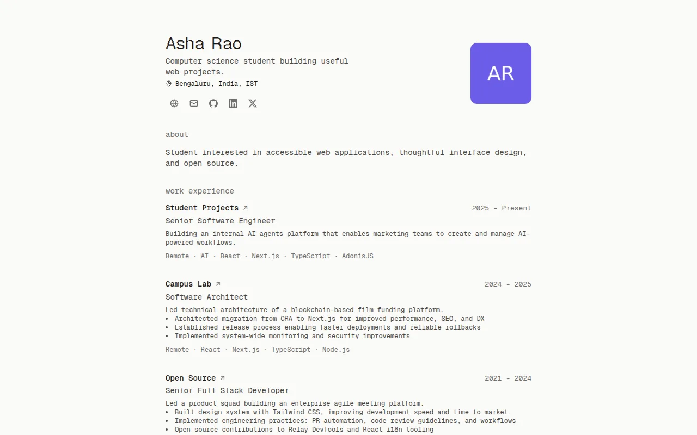
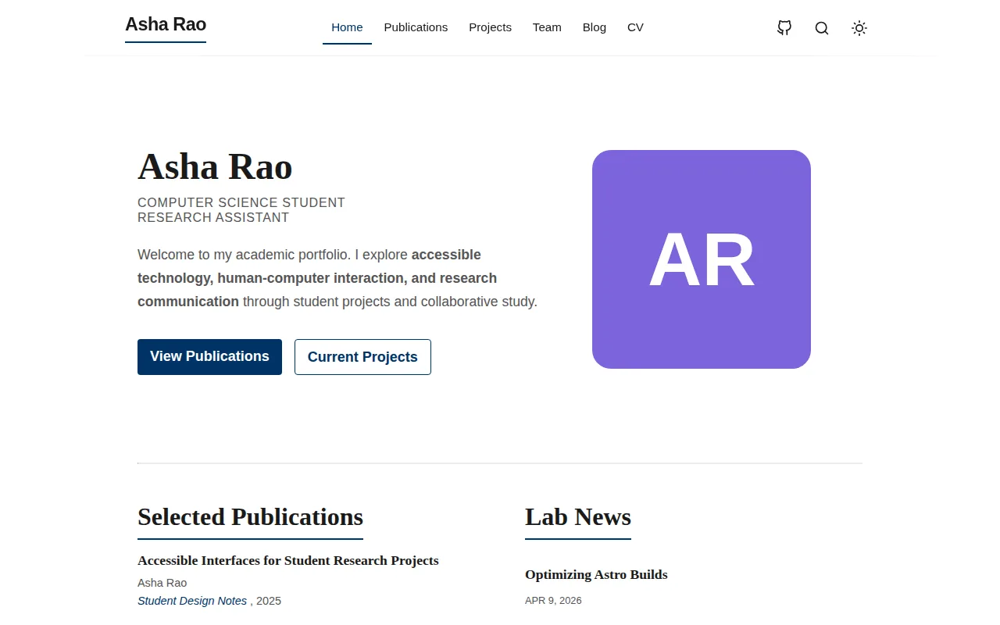
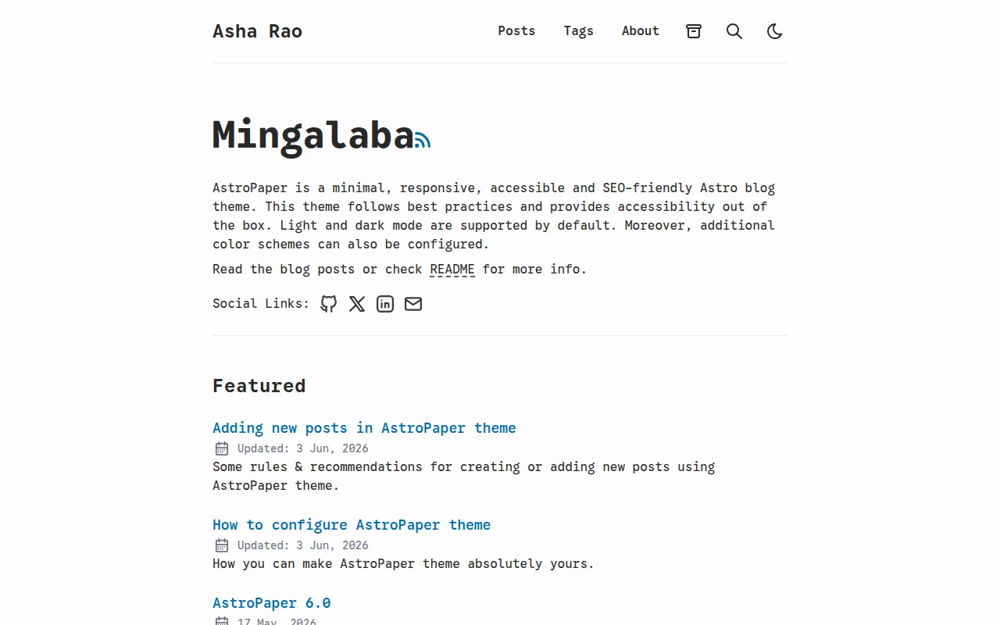
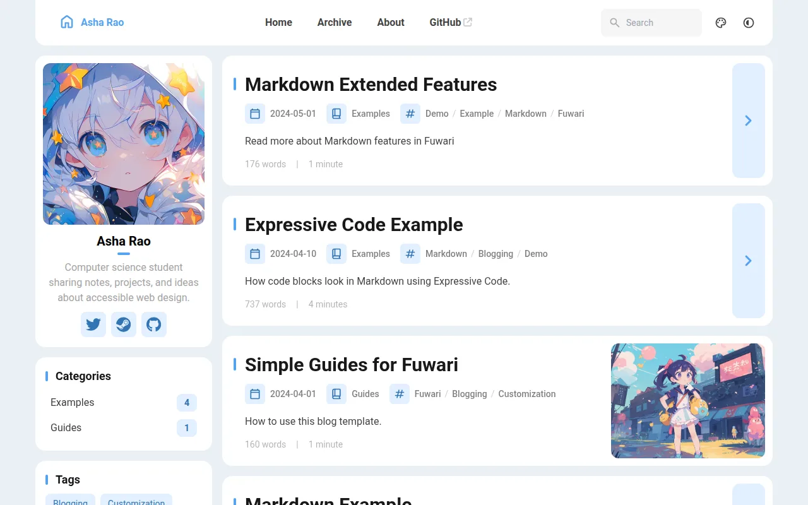
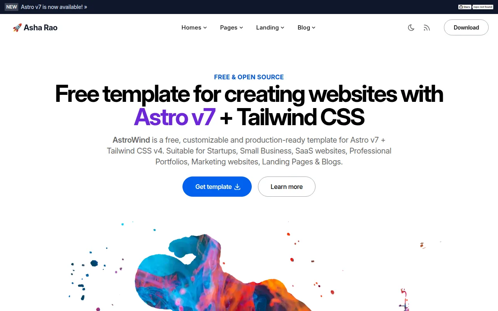
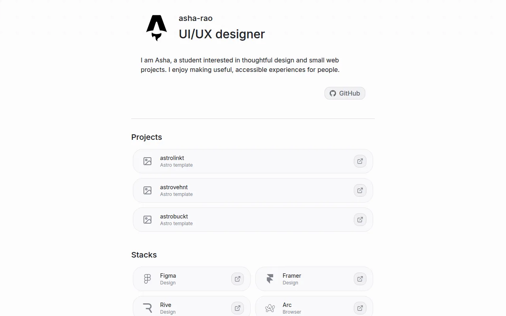

<h1>LeafCloud</h1>

**Static hosting, built in India.** Put your site online at `your-name.leafcloud.app`, served from servers in India.

[Website](https://leafcloud.in) · [Templates](https://leafcloud.in/templates/) · [Docs](https://leafcloud.in/docs/)

## Free templates for your personal site

Pick a template, paste one line into your coding agent (Claude Code, Codex, Cursor or any other), answer a few
questions, and your site is live. Want to change something later? Ask your agent.

<table>
  <tr>
    <td width="50%" valign="top">
      
      <h3><a href="https://github.com/leafcloud-in/template-sphere">Sphere</a> · Portfolio</h3>
      A polished home for your work, projects, and writing.
    </td>
    <td width="50%" valign="top">
      
      <h3><a href="https://github.com/leafcloud-in/template-nano">Nano</a> · Portfolio</h3>
      A simple, personal page for your work and the links that matter.
    </td>
  </tr>
  <tr>
    <td width="50%" valign="top">
      
      <h3><a href="https://github.com/leafcloud-in/template-cv">CV</a> · Resume</h3>
      A clear online CV to share with recruiters and collaborators.
    </td>
    <td width="50%" valign="top">
      
      <h3><a href="https://github.com/leafcloud-in/template-scholar">Scholar</a> · Academic</h3>
      A professional profile for your research, writing, and talks.
    </td>
  </tr>
  <tr>
    <td width="50%" valign="top">
      
      <h3><a href="https://github.com/leafcloud-in/template-paper">Paper</a> · Blog</h3>
      A calm, readable place to publish notes, ideas, and stories.
    </td>
    <td width="50%" valign="top">
      
      <h3><a href="https://github.com/leafcloud-in/template-fuwari">Fuwari</a> · Blog</h3>
      A bright, expressive blog for sharing what you are learning.
    </td>
  </tr>
  <tr>
    <td width="50%" valign="top">
      
      <h3><a href="https://github.com/leafcloud-in/template-astrowind">AstroWind</a> · Launch page</h3>
      A focused page for introducing a project, club, or new idea.
    </td>
    <td width="50%" valign="top">
      
      <h3><a href="https://github.com/leafcloud-in/template-links">Links</a> · Link-in-bio</h3>
      One neat page that brings your projects and social links together.
    </td>
  </tr>
</table>

## How it works

1. Open a template and copy its agent prompt.
2. Paste it into your coding agent.
3. Answer a few questions: your name, a short bio, your links.
4. Your site goes live at `your-name.leafcloud.app`.

You need a LeafCloud account to deploy. [Join the waitlist](https://leafcloud.in/#start) to get one.

## Credits

Every template is built on an open-source project and keeps its original licence. Thank you to Mark Horn, Bartosz
Jarocki, Sat Naing, saicaca, onWidget, Shravan Goswami and flamrdevs. Each repository names its original author and lists
what we changed.
